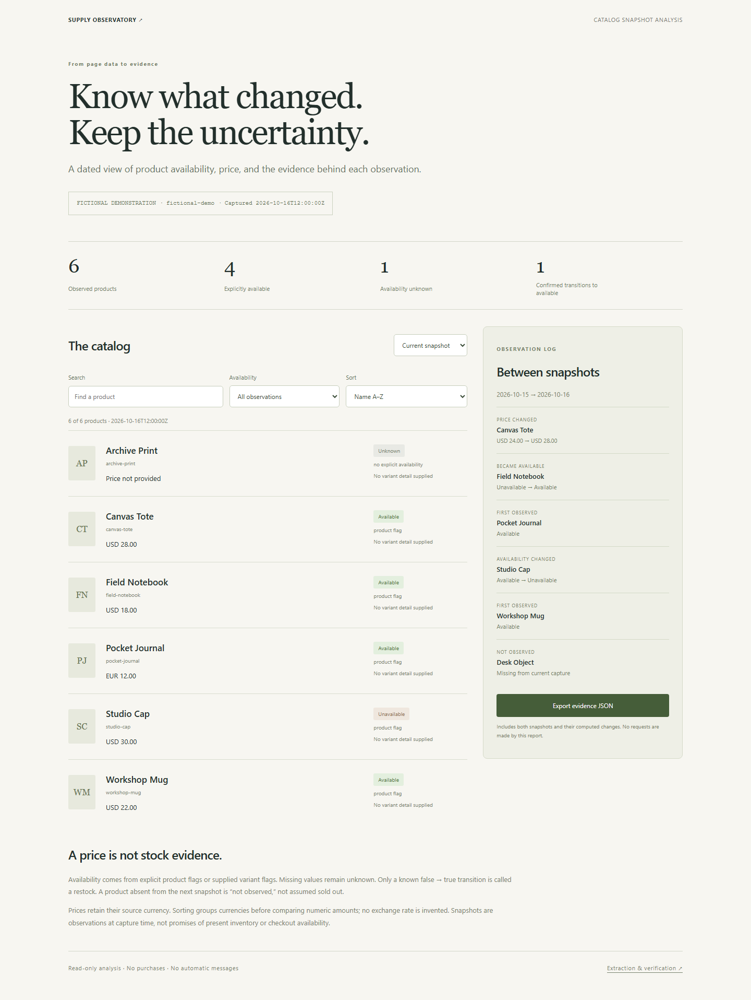

# Supply Observatory

A reproducible catalog-analysis workbench developed from the original `openai_merch_bot` stock-monitoring experiment. Extract saved Shopify-style product data, compare dated snapshots, and explore availability evidence in a standalone HTML report.



## Try the report

Open `demo/index.html` directly, or serve this repository locally. It contains six **fictional** products, paired snapshots, price changes, unknown availability, a known restock, and a missing observation. Search, filter, switch snapshots, sort by currency/price, and export the complete evidence JSON. No credentials, account, build step or network calls are needed to use the report.

```sh
python studio.py --demo --output report.local.html
```

Requires Python 3.10+. Runtime dependencies: standard library only.

## Analyze saved data

```sh
python studio.py --input saved-page.html --output report.local.html --snapshot current.local.json
python studio.py --input new-page.html --previous current.local.json --output comparison.local.html
```

Inputs can be product JSON, a normalized `supply-snapshot/v1`, or saved HTML with JSON-bearing script blocks. The parser decodes JSON arrays/objects inside Next.js Flight string wrappers without executing JavaScript. It handles product objects with `id`, `handle`, `title`, explicit availability, price range and optional variant nodes/edges. It is a bounded schema extractor, not a universal JavaScript or storefront parser. HTML without recognized products is an extraction failure, **not an empty catalog**. Inputs are capped at 20 MiB, 50,000 traversal nodes, 12 levels and 5,000 products.

Outputs must be distinct from input paths. Existing output files are preserved unless `--force` is explicitly supplied. Local reports and snapshots are ignored by Git. Reports contain the imported product data; choose deliberately before sharing them.

## What changed from the original monitor

- A positive price or a `buyable` substring no longer implies stock. Only boolean product/variant flags support availability; missing evidence remains unknown.
- Currency is retained from the source. Prices are compared as decimals; equivalent `12.0` and `12.00` do not create a price-change event.
- Conflicting duplicate availability flags produce unknown evidence, rather than an arbitrary restock.
- Only a known **false → true** transition is a restock. First observations establish a baseline, new products are “first observed,” and absent products are “not observed.”
- HTML and script strings are safely decoded/escaped. User-controlled titles render as text. The generated report has no external resources and blocks network connections.
- The former automatic 20-second polling/Telegram loop is retained in Git history. The current entry point builds an explicit local report and does not read Telegram settings or send messages. `openai_supply_all_in_one.py` is an import-safe compatibility entry point for the new CLI.

## Live-source limitation

As checked on **October 16, 2026**, [the original storefront](https://supply.openai.com/) serves a redirect notice. No live inventory is claimed by this repository. The offline example is fabricated and clearly labeled.

An explicit one-shot read remains available:

```sh
python studio.py --fetch --output live.local.html --snapshot live.local.json
```

It only targets the configured public storefront, uses a 20-second timeout and bounded response size, and rejects redirects away from that host or pages without supported product data. Failed extraction preserves existing snapshots. There is no checkout, purchasing, automatic alerting or schedule. If the source later returns a catalog, capture timestamps still describe past observations, not current inventory guarantees.

## Verify

```sh
python -m unittest discover -s tests -v
npm ci
npm run build:demo
npx playwright install chromium
npm run test:ui
```

Twelve Python tests cover escaped Flight payloads, variant states, conflicting duplicates, numeric/currency rules, extraction failures, normalized schemas, real comparisons, HTML escaping, import side effects, output protection, and redirect rejection. Four browser tests exercise filters, snapshot switching, currency grouping, empty states, downloaded evidence, and 390/1440px layouts. CI checks demo reproducibility against the committed HTML. No live purchases or messages are part of verification.

`catalog.py` owns extraction and comparison; `studio.py` owns explicit input/output; `web/` contains the report template and interface. This is an independent project and is not affiliated with OpenAI or Shopify.
